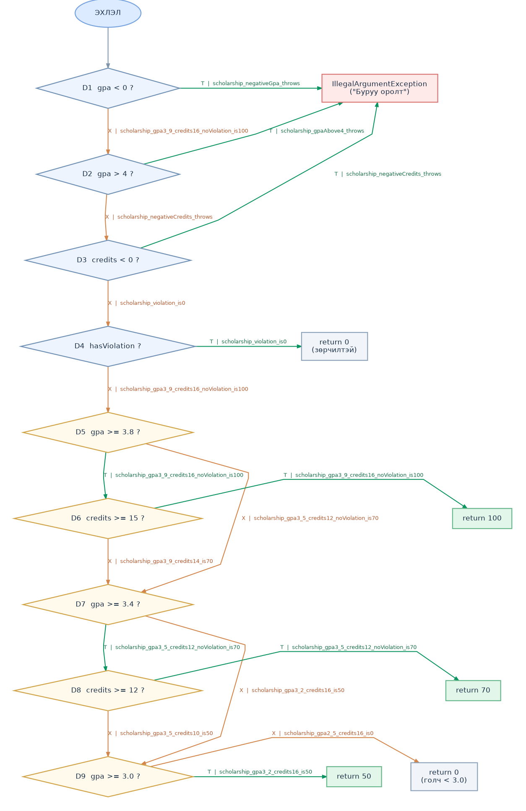

# Лаб 9: Код хамралт — JaCoCo

Оюутан: Ган-Оргил  
Код: B232270091

## Орчин

`java -version`:

```
openjdk version "17.0.20.1" 2026-08-18
OpenJDK Runtime Environment Temurin-17.0.20.1+1 (build 17.0.20.1+1)
OpenJDK 64-Bit Server VM Temurin-17.0.20.1+1 (build 17.0.20.1+1, mixed mode, sharing)
```

`mvn -version`:

```
Apache Maven 3.9.12 (848fbb4bf2d427b72bdb2471c22fced7ebd9a7a1)
Maven home: C:\Users\enhta\Desktop\New folder\.lab8-work\tools\apache-maven-3.9.12
Java version: 17.0.20.1, vendor: Eclipse Adoptium, runtime: C:\Users\enhta\Desktop\New folder\.lab8-work\tools\jdk-17.0.20.1+1
Default locale: en_US, platform encoding: UTF-8
OS name: "windows 11", version: "10.0", arch: "amd64", family: "windows"
```

(Гаралтууд `results/java-version.txt`, `results/mvn-version.txt`-д бий.)

## A. Happy path тестүүд ба эхний хэмжилт

5 happy-path тест: `letterGrade_95_isA`, `letterGrade_85_isB`, `gpa_95_85_is3_5`,
`scholarship_gpa3_9_credits16_noViolation_is100`, `scholarship_gpa3_5_credits12_noViolation_is70`
(`results/mvn-verify-A.txt`: `Tests run: 5, Failures: 0`).

`results/jacoco-A.csv`-аас:

| Хэмжүүр | Covered | Missed | Хамралт |
|---|---|---|---|
| Line | 15 | 10 | 15/25 = 60.0% |
| Branch | 20 | 21 | 20/41 ≈ 48.8% |

**Ажиглалт.** Улаан (огт хүрээгүй) мөрүүд нь бүгд алдааны болон "доод" замууд: гурван
`throw new IllegalArgumentException` мөр (21, 32, 49), `letterGrade`-ийн C/D/F буцаалт (25–27),
`gpa`-ийн `case "C"`/`case "D"` (39–40), `scholarship`-ийн `return 50` ба сүүлийн `return 0` (54–55).
Шар ромботой мөрүүд нь нөхцлийн зөвхөн нэг талыг шалгасан газрууд: мөр 20, 31, 48-ийн `||`
нөхцлүүдийн "үнэн" тал хэзээ ч биелээгүй, мөр 51-д `hasViolation == true` тест байхгүй, мөр 52–53-ийн
`&&`-ийн "голч хангасан ч кредит дутуу" салаа, мөр 36-гийн `switch`-ийн C/D/default салаанууд дутуу.

## B. CFG ба 100% branch хамралт



`scholarship()`-ийн CFG (`cfg.png`, гараар зурсан). JaCoCo `||`/`&&` нөхцөл бүрийг тусдаа салаа
гэж тоолдог тул зангилаа бүр нэг энгийн нөхцөл байна. Ирмэг бүр дээрх нэр нь тест файлын бодит метод:

| Зангилаа | Ирмэг | Дайрах тест |
|---|---|---|
| D1 `gpa < 0` | T → throw | `scholarship_negativeGpa_throws` |
| D1 | F → D2 | бусад бүх scholarship тест |
| D2 `gpa > 4` | T → throw | `scholarship_gpaAbove4_throws` |
| D2 | F → D3 | `scholarship_negativeCredits_throws` + throw-гүй бүх тест |
| D3 `credits < 0` | T → throw | `scholarship_negativeCredits_throws` |
| D3 | F → D4 | throw-гүй бүх тест |
| D4 `hasViolation` | T → return 0 | `scholarship_violation_is0` |
| D4 | F → D5 | үлдсэн 6 тест (доорх D5-ын хоёр мөрийн нийлбэр) |
| D5 `gpa >= 3.8` | T → D6 | `scholarship_gpa3_9_credits16_noViolation_is100`, `scholarship_gpa3_9_credits14_is70` |
| D5 | F → D7 | `scholarship_gpa3_5_credits12_noViolation_is70`, `scholarship_gpa3_5_credits10_is50`, `scholarship_gpa3_2_credits16_is50`, `scholarship_gpa2_5_credits16_is0` |
| D6 `credits >= 15` | T → return 100 | `scholarship_gpa3_9_credits16_noViolation_is100` |
| D6 | F → D7 | `scholarship_gpa3_9_credits14_is70` |
| D7 `gpa >= 3.4` | T → D8 | `scholarship_gpa3_5_credits12_noViolation_is70`, `scholarship_gpa3_5_credits10_is50`, `scholarship_gpa3_9_credits14_is70` |
| D7 | F → D9 | `scholarship_gpa3_2_credits16_is50`, `scholarship_gpa2_5_credits16_is0` |
| D8 `credits >= 12` | T → return 70 | `scholarship_gpa3_5_credits12_noViolation_is70`, `scholarship_gpa3_9_credits14_is70` |
| D8 | F → D9 | `scholarship_gpa3_5_credits10_is50` |
| D9 `gpa >= 3.0` | T → return 50 | `scholarship_gpa3_5_credits10_is50`, `scholarship_gpa3_2_credits16_is50` |
| D9 | F → return 0 | `scholarship_gpa2_5_credits16_is0` |

Хэсэг A-гийн дараа хамрагдаагүй ирмэгүүд (D1–D3 T, D4 T, D6 F, D8 F, D9 T/F) шинэ тестийн жагсаалт болсон.
`letterGrade`-д сөрөг/100-аас их оноо болон C/D/F, `gpa`-д null/хоосон массив ба C/D/default салаа нэмсэн.

Нийт **21 тест** шаардлагатай болсон (`results/mvn-verify-B.txt`: `Tests run: 21, Failures: 0`).
`results/jacoco-B.csv`: BRANCH_COVERED 41, **BRANCH_MISSED 0**; LINE_COVERED 25, **LINE_MISSED 0** —
Branch 41/41 = 100%, Line 25/25 = 100%.
